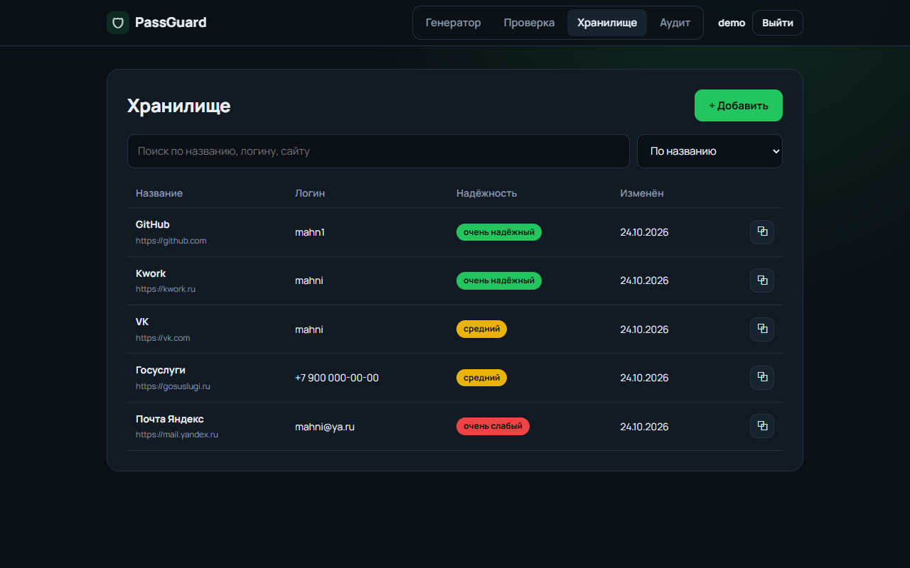
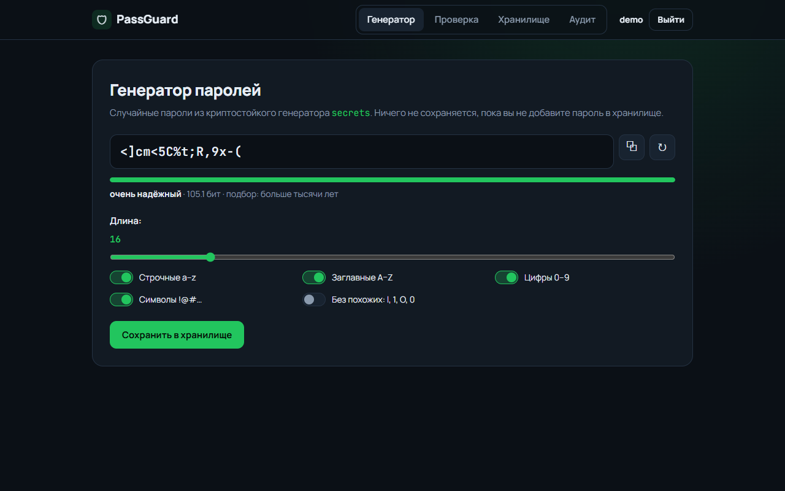
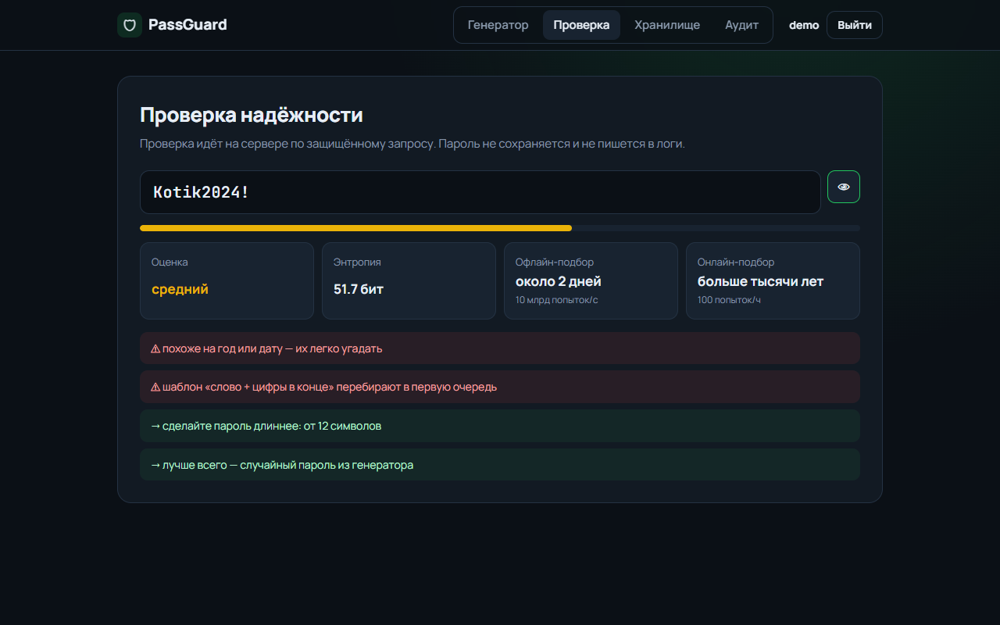
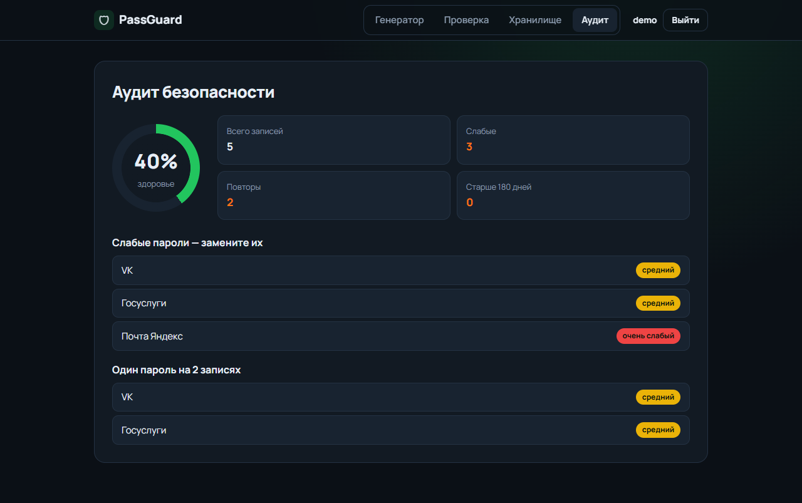
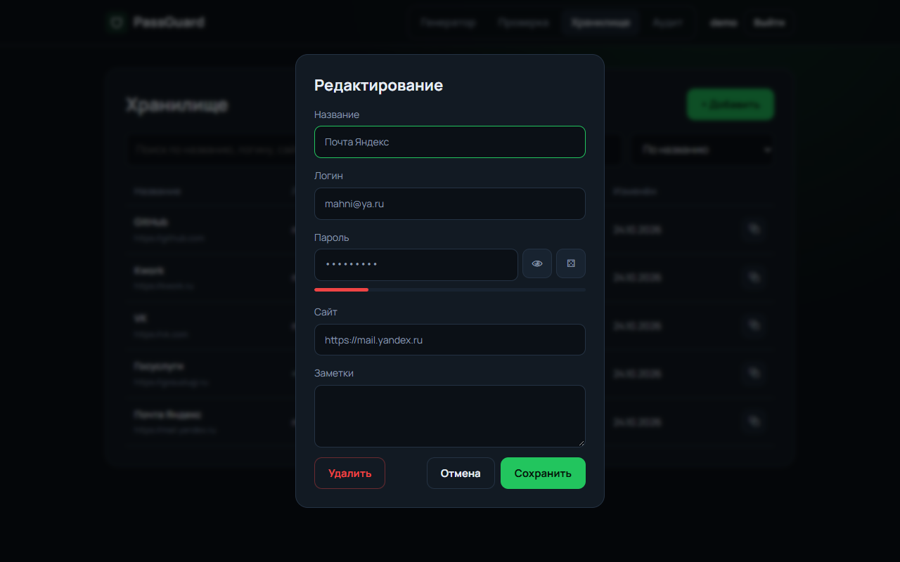

# PassGuard

[](https://github.com/mahn1/passguard/actions/workflows/ci.yml)


Генератор паролей, проверка их надёжности и зашифрованное хранилище с аудитом безопасности.
Бэкенд на FastAPI + SQLAlchemy, REST API с JWT-авторизацией, интерфейс на чистом JS.



## Возможности

- **Генератор** — криптостойкий `secrets`, длина 6–128, наборы символов, исключение похожих (`l`, `1`, `O`, `0`).
  В пароле гарантированно есть хотя бы один символ из каждого выбранного набора.
- **Проверка надёжности** — энтропия, время подбора офлайн (10 млрд попыток/с) и онлайн (100 попыток/ч), оценка 0–4.
  Ловит словарные пароли (включая русские и набранные в английской раскладке: `gfhjkm`, `йцукен`),
  leet-замены (`P@ssw0rd`), клавиатурные ряды, последовательности, повторы, годы и шаблон «слово + цифры».
- **Хранилище (CRUD)** — записи с названием, логином, адресом и заметками; пароли шифруются Fernet (AES-128-CBC + HMAC).
  Поиск без учёта регистра (в том числе кириллицы), сортировка по названию, дате и надёжности.
- **Аудит** — слабые пароли, один пароль на нескольких сайтах (через HMAC-отпечатки, без расшифровки),
  пароли старше 180 дней и общий «индекс здоровья» хранилища.
- **Изоляция пользователей** — чужие записи недоступны и неотличимы от несуществующих (404).

| Генератор | Проверка |
|---|---|
|  |  |
| **Аудит** | **Редактирование** |
|  |  |

## Запуск

```bash
git clone https://github.com/mahn1/passguard.git
cd passguard
python -m venv .venv
source .venv/bin/activate        # Windows: .venv\Scripts\activate
pip install -r requirements.txt
uvicorn app.main:app --reload
```

Интерфейс — http://localhost:8000, документация API (Swagger) — http://localhost:8000/docs.

При первом запуске приложение само сгенерирует `SECRET_KEY` и `ENCRYPTION_KEY` и запишет их в `.env`.
Настройки можно задать заранее — см. [`.env.example`](.env.example). Для PostgreSQL достаточно поменять `DATABASE_URL`.

## API

| Метод | Путь | Описание |
|---|---|---|
| `POST` | `/api/auth/register` | Регистрация (слабый мастер-пароль отклоняется) |
| `POST` | `/api/auth/login` | Вход, возвращает JWT |
| `GET` | `/api/auth/me` | Текущий пользователь |
| `POST` | `/api/tools/generate` | Сгенерировать 1–10 паролей с оценкой |
| `POST` | `/api/tools/check` | Проверить надёжность пароля |
| `GET` | `/api/entries?q=&sort=title\|updated\|weakest` | Список записей без паролей |
| `POST` | `/api/entries` | Создать запись |
| `GET` | `/api/entries/{id}` | Запись с расшифрованным паролем |
| `PATCH` | `/api/entries/{id}` | Частичное обновление |
| `DELETE` | `/api/entries/{id}` | Удалить запись |
| `GET` | `/api/entries/audit` | Аудит хранилища |

Пароль для проверки передаётся методом `POST` в теле запроса, чтобы не попадать в URL и логи веб-сервера.

```bash
curl -X POST localhost:8000/api/tools/check -H "Content-Type: application/json" -d '{"password": "Masha1995"}'
```

```json
{
  "score": 0,
  "label": "очень слабый",
  "entropy_bits": 39.6,
  "crack_time_offline": "около 41 секунды",
  "crack_time_online": "больше тысячи лет",
  "warnings": [
    "похоже на год или дату — их легко угадать",
    "шаблон «слово + цифры в конце» перебирают в первую очередь"
  ],
  "suggestions": [
    "сделайте пароль длиннее: от 12 символов",
    "добавьте спецсимволы: ! # % & …",
    "лучше всего — случайный пароль из генератора"
  ]
}
```

## Структура

```
app/
├── main.py            # приложение, роутеры, статика
├── config.py          # настройки из окружения, автогенерация ключей
├── db.py, models.py   # SQLAlchemy 2.0: User, Entry
├── schemas.py         # Pydantic-схемы и валидация
├── security.py        # bcrypt, JWT, Fernet, HMAC-отпечатки
├── generator.py       # генератор паролей
├── strength.py        # оценка надёжности
├── routers/           # auth, tools, entries
└── static/            # интерфейс (HTML/CSS/JS без сборки)
tests/                 # pytest: генератор, оценка, API
```

## Тесты и линтер

```bash
pip install -r requirements-dev.txt
pytest
ruff check . && ruff format --check .
```

CI в GitHub Actions прогоняет линтер и 40 тестов на Python 3.11, 3.12 и 3.13.

## Безопасность: что сделано и чего нет

- Мастер-пароли хранятся как bcrypt-хеши; ошибка входа одинакова для неверного имени и неверного пароля.
- Пароли в хранилище зашифрованы на сервере ключом `ENCRYPTION_KEY`. Это **не** zero-knowledge-модель, как у
  Bitwarden: владелец сервера с ключом может расшифровать данные. Для учебного и домашнего использования этого
  достаточно, для продакшена нужно шифрование на клиенте ключом, выведенным из мастер-пароля.
- Повторы ищутся по HMAC-отпечаткам с привязкой к пользователю — одинаковые пароли разных людей не сопоставить.
- Токен хранится в `sessionStorage` и удаляется при закрытии вкладки; пользовательские данные экранируются при выводе.
- Нет ограничения частоты запросов на вход — перед публикацией в интернет его стоит добавить (например, на уровне nginx).

## Лицензия

MIT
